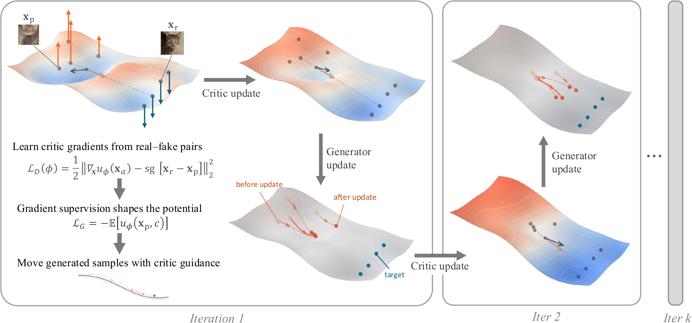

<h1 align="center">NextGAN: Towards Simple and Scalable GAN Training<br>for Image and Video Generation</h1>

<p align="center">
Xinhao Lou<sup>1,∗</sup> · Dongye Xie<sup>2,∗</sup> · Peng Sun<sup>1,4,∗</sup> · Chenyi Zhuang<sup>3</sup> · Kaicheng Yu<sup>1,†</sup> · Tao Lin<sup>1,†</sup>
</p>

<p align="center">
<sup>1</sup> Westlake University · <sup>2</sup> University of Cambridge<br>
<sup>3</sup> Independent Researcher · <sup>4</sup> Zhejiang University
</p>

<p align="center">
<sup>∗</sup> Equal contribution. <sup>†</sup> Corresponding authors.
</p>

<p align="center">
<a href="https://arxiv.org/abs/2611.06270">Paper</a> ·
<a href="#imagenet-results">Results</a> ·
<a href="imgnet/README.md">ImageNet guide</a> ·
<a href="#todo">TODO</a>
</p>

NextGAN learns how to update a generator by supervising the input gradients of
a scalar critic.

[](assets/readme/nextgan-pipeline.png)

<p align="center"><em>NextGAN training pipeline (Figure 2 in the paper).</em></p>

## ImageNet results

Paper results from [Table 1](https://arxiv.org/html/2611.06270v1#S4.SS1) and
our GitHub reproduction results are shown together below.
All use one network evaluation and no classifier-free guidance.

| Source | Method | Generator | FID ↓ | IS ↑ |
| --- | --- | --- | --- | --- |
| Paper | NextGAN | JiT-B | 2.87 | 207.1 |
| Paper | NextGAN | DiT-XL/1 + VA-VAE | 1.54 | 243.5 |
| Paper | NextGAN, adversarial form | DiT-XL/1 + VA-VAE | 1.36 | 241.7 |
| **Github** | **NextGAN** | **JiT-B** | **2.75** | **213.0** |
| **Github** | **NextGAN** | **DiT-XL/1 + VA-VAE** | **1.27** | **258.9** |

The GitHub results use EMA weights, 50K images, seed 1, eight GPU ranks,
batch size 256 per GPU and BF16, with one training seed per model.

**Code and recipe status.** The current ImageNet implementation provides the
field-regression objective with unit weight. The paper's experimental recipe
uses a different regression scale in [Appendix A](https://arxiv.org/html/2611.06270v1#A1).
The included DiT configuration is described in the
[ImageNet guide](imgnet/README.md#included-dit-recipe). Exact Appendix A
configuration alignment and the adversarial-form implementation remain release
follow-ups.

## How it works

NextGAN compares reference and generated images through frozen representation
models. Each real–generated feature pair defines a displacement target. A
scalar critic learns a potential whose input gradient matches that displacement
at randomly interpolated features. The generator then increases the potential
at its generated endpoints.

For images, the training representations are MAE, SigLIP2 and ResNet18. Their
weights stay frozen while gradients pass through them to the generator.
Inference uses only the generator and, for latent models, the decoder.

## Getting started

Use **Linux, CUDA, Bash and Python 3.10–3.12**. The included DiT training recipe
uses eight GPUs; its evaluation protocol also uses eight GPU ranks.

```bash
git clone https://github.com/LINs-lab/NextGAN.git
cd NextGAN/imgnet
```

Prepare the assets listed in [ASSETS.md](imgnet/ASSETS.md), then edit the paths in
[`configs/reproduced/nextgan_dit_vavae_256.yaml`](imgnet/configs/reproduced/nextgan_dit_vavae_256.yaml):

- ImageNet VA-VAE latent shards and pretrained DiT-XL/1 initialization.
- The matching converted VA-VAE model and channel statistics.
- MAE, SigLIP2 and ResNet18 weights for training.
- Inception weights and ImageNet reference statistics for FID evaluation.

Public NextGAN checkpoint downloads, a versioned asset manifest and a standalone
sampling example are pending. The commands below use assets supplied locally.

### Check assets

```bash
export DM_MODEL_ZOO=/path/to/model_zoo
export DM_DATA_ZOO=/path/to/data_zoo

python3 reproduce.py \
  --config configs/reproduced/nextgan_dit_vavae_256.yaml \
  --stage check \
  --runs-dir ./reproductions/nextgan-dit-256
```

The reproduction entry creates a virtual environment, installs the pinned
dependencies and checks the configured assets. Use an explicit `--config` to
select the NextGAN recipe.

### Train and evaluate

After the asset check succeeds:

```bash
EVAL_NPROC_PER_NODE=8 python3 reproduce.py \
  --config configs/reproduced/nextgan_dit_vavae_256.yaml \
  --skip-install \
  --runs-dir ./reproductions/nextgan-dit-256
```

This trains for 100K generator updates and evaluates the final EMA checkpoint
using 50K images. It saves resolved configurations, source and asset hashes,
dependency versions, logs and metrics in the run directory. The
[ImageNet guide](imgnet/README.md) covers individual checkpoints, checkpoint
sweeps, resuming training and alternative NextGAN configurations.

## TODO

- [ ] Release the Wan2.1 code.
- [ ] Release NextGAN2.0.
- [ ] Release the MiniMax-H3 code.
- [ ] Release the model checkpoints.

## Citation

```bibtex
@article{lou2026nextgan,
  title={NextGAN: Towards Simple and Scalable GAN Training for Image and Video Generation},
  author={Lou, Xinhao and Xie, Dongye and Sun, Peng and Zhuang, Chenyi and Yu, Kaicheng and Lin, Tao},
  journal={arXiv preprint arXiv:2611.06270},
  year={2026},
  url={https://arxiv.org/abs/2611.06270}
}
```

## Acknowledgments and license

This implementation builds on work including UCGM, JiT and FD-Loss, alongside
the pretrained representation models used for training and evaluation. Original
project code is licensed under [Apache 2.0](LICENSE). Adapted third-party
components retain their upstream terms; see [THIRD_PARTY_NOTICES.md](THIRD_PARTY_NOTICES.md)
for attribution and component-specific licenses. Model weights and datasets
have their own terms.
